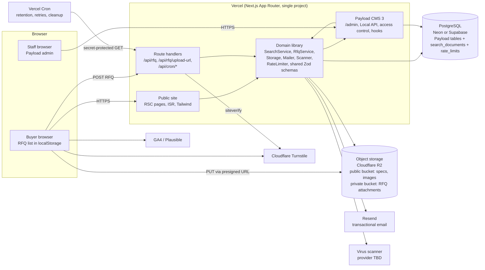
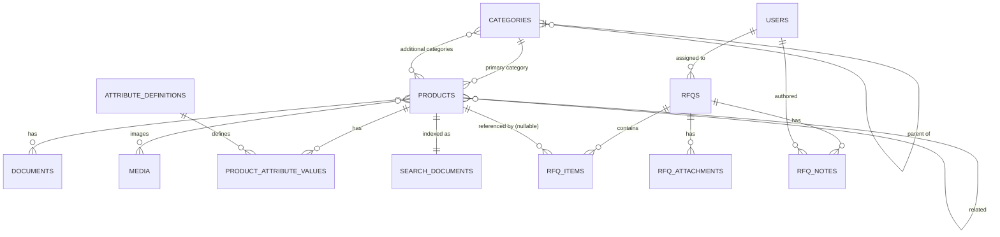
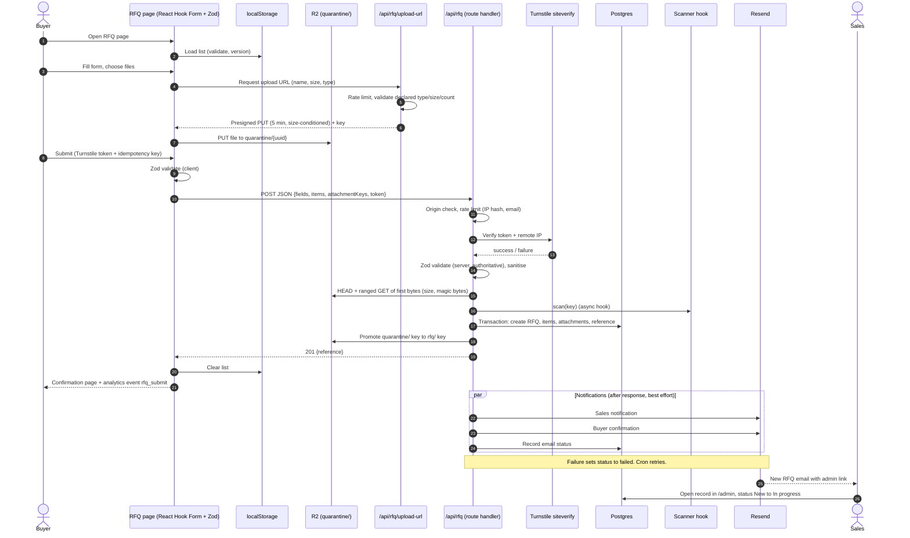

# RC Quartermaster LLC: Architecture

Status: **Stage 1 draft, awaiting approval**.

## 1. System overview

A single Next.js (App Router) application contains the public site, the Payload CMS 3 admin and the API/route handlers. It is deployed to Vercel and talks to managed Postgres, S3-compatible object storage, Resend and Cloudflare Turnstile.

Key principles:
1. **Procurement first**: every page leads toward finding a SKU and submitting an RFQ.
2. **Published-only public surface**: public code paths can only read published records (enforced by Payload access control and again in query helpers).
3. **Provider interfaces**: search, storage, email, virus scanning and rate limiting sit behind small TypeScript interfaces, so swapping a vendor touches one module.
4. **Boring and portable**: Postgres, S3 API, plain HTTP. The app can run in Docker on any Node host. No Vercel KV/Edge Config/Blob dependency.
5. **Accessibility is a build constraint**, not a phase: design tokens, components and CI checks enforce it.

## 2. Component diagram



### Repository layout (target for Stage 2)
```
src/
  app/
    (site)/            public pages (home, categories, products, search, rfq, services, about, contact, legal)
    (payload)/         Payload admin + API routes (generated)
    api/rfq/           submit + upload-url
    api/cron/          retention, email-retry, quarantine-cleanup
    sitemap.ts  robots.ts  not-found.tsx
  collections/         Users, Categories, AttributeDefinitions, Products, Media, Documents, Rfqs, RfqAttachments, Pages
  globals/             SiteSettings
  lib/
    search/            SearchService.ts, PostgresSearchService.ts, indexer.ts
    rfq/               schema.ts (Zod, shared), service.ts, reference.ts, list-store.ts (client)
    storage/           Storage.ts (interface), R2Storage.ts
    mail/              Mailer.ts, ResendMailer.ts, templates/
    security/          turnstile.ts, rate-limit.ts, csp.ts, attachment-validation.ts, scanner.ts
    csv/               import.ts, export.ts, sanitize.ts
    seo/               jsonld.ts, metadata.ts
  components/          UI primitives (a11y-first), catalogue, rfq
  config/redirects.ts  301 map (placeholder)
  env.ts               Zod-validated environment
scripts/               import-csv.ts, seed.ts, reindex.ts
tests/                 unit/, e2e/, a11y/
docs/
```

## 3. Technology decisions (ADR summary)

| # | Decision | Rationale | Alternatives and trade-offs |
|---|---|---|---|
| ADR-1 | Payload 3 inside the Next.js app | One deploy, one repo, Local API avoids network hops; admin comes with auth, RBAC, drafts, versions | Separate CMS adds cost and latency |
| ADR-2 | Neon Postgres (recommended) | Serverless pooling, branching gives per-preview databases; plain Postgres so Supabase is a drop-in | Supabase equal for this use; confirm with client (OPEN_QUESTIONS) |
| ADR-3 | Cloudflare R2 via S3 API (recommended) | No egress fees, S3 portability, private bucket + signed URLs, lifecycle rules for quarantine cleanup | Vercel Blob is simpler but proprietary; private blob support and lifecycle control are weaker |
| ADR-4 | Direct-to-storage RFQ uploads via presigned PUT | Vercel serverless request bodies are limited (about 4.5 MB), RFQ files can be larger; avoids proxying bytes through functions | Proxy upload simpler but caps file size |
| ADR-5 | Postgres FTS + trigram via a denormalised `search_documents` table | No extra service, fast enough for thousands of SKUs, same document shape later pushed to Meilisearch/Algolia | Raw `products` tsvector column couples search to the Payload schema and joins |
| ADR-6 | Rate limiting backed by a Postgres table plus Vercel WAF rules as an outer layer | Stays inside approved stack; no Redis | Upstash Redis is faster, but is a new dependency (needs approval) |
| ADR-7 | Plain TypeScript HTML/text email templates | No extra dependency | React Email nicer DX (needs approval) |
| ADR-8 | RFQ saved before any email is sent; email is best-effort with retry | Never lose a lead because Resend is down | Synchronous email can fail the whole request |
| ADR-9 | Single `role` field on users, access by function helpers | Simple, auditable | Multi-role arrays add complexity that three roles do not justify |
| ADR-10 | Redirects as a typed file loaded into `next.config` with `statusCode: 301` | Matches brief; reviewable in PRs | Admin-managed redirects collection can come later |
| ADR-11 | No public prices; Product JSON-LD omits `offers` | Quote-based business; avoids invalid markup | Add when/if pricing is published |

## 4. Data model

Payload collections map to Postgres tables (Payload's Drizzle adapter). Names below are collection slugs.

### 4.1 ER diagram



### 4.2 Collections and fields

**users** (auth-enabled)
| Field | Type | Notes |
|---|---|---|
| email | email, unique | login |
| name | text | |
| role | select: `admin`, `catalogue_manager`, `sales` | required, default `sales` (least privilege); only admin can change |
| password hash, lock fields | managed by Payload | `maxLoginAttempts: 5`, `lockTime` 15 min |
| lastLoginAt | date | |

**categories** (drafts enabled)
| Field | Type | Notes |
|---|---|---|
| name | text | |
| slug | text | unique among siblings |
| parent | relationship to categories | optional; cycle check in hook |
| path | text, unique, indexed | computed, e.g. `janitorial/floor-care`; recomputed for descendants on change |
| depth | number | computed |
| description | rich text | |
| image | relationship to media | |
| sortOrder | number | |
| seoTitle, seoDescription | text | |
| _status | draft / published | Payload versions |

**attribute_definitions**
| Field | Type | Notes |
|---|---|---|
| key | text, unique | machine name, e.g. `glove_size` |
| label | text | display |
| type | select: `text`, `number`, `boolean`, `enum` | |
| unit | text | optional |
| options | array of {value, label} | for `enum` |
| filterable | checkbox | becomes a facet |
| categories | relationship (hasMany) to categories | optional scope; empty = all |
| sortOrder | number | |

**products** (drafts + versions enabled)
| Field | Type | Notes |
|---|---|---|
| sku | text, unique | normalised (trim, uppercase); index |
| name | text | |
| slug | text, unique | |
| summary | textarea (<= 300) | card and meta description fallback |
| description | rich text | rendered through a React serializer |
| category | relationship to categories | primary, required to publish |
| additionalCategories | relationship (hasMany) | |
| manufacturer | text | optional |
| manufacturerPartNumber | text | optional |
| unitOfMeasure | text | e.g. EA, BX, CS |
| countryOfOrigin | text | optional, subject to client confirmation |
| availability | select: `available`, `on_request`, `discontinued` | default `available` |
| specifications | array {label, value, unit} | approved spec table |
| attributes | array {attribute -> attribute_definitions, value (text) , valueNumber, valueBoolean} | stored as `product_attribute_values` |
| images | array {image -> media, caption} | first is primary |
| documents | relationship (hasMany) to documents | only published ones render |
| relatedProducts | relationship (hasMany) to products | |
| seoTitle, seoDescription | text | |
| approvedBy, approvedAt | relationship to users, date | set by hook when published |
| _status, publishedAt | managed | |

Validation to publish: SKU, name, summary, category, at least one image (configurable), alt text on images.

**media** (upload, public bucket): `alt` (required), `width`, `height`, `focalX/Y`, generated sizes (AVIF/WebP). Public read.

**documents** (upload, public bucket)
| Field | Type | Notes |
|---|---|---|
| title | text | |
| type | select: `spec_sheet`, `certificate`, `sds`, `brochure`, `other` | |
| file | upload | PDF only by default (config allow-list), max 25 MB |
| versionLabel | text | optional |
| effectiveDate, expiryDate | date | certificates show expiry |
| status | select `draft` / `published` | public read filter. Document files are served via unguessable keys but are treated as public only when published; unpublish deletes public access by moving/rewriting key (see section 7.4) |
| accessibleAlternative | checkbox | notes a tagged-PDF/alternative exists |

**rfqs**
| Field | Type | Notes |
|---|---|---|
| reference | text, unique, indexed | `RCQ-202611-7K3M9Q` |
| status | select `new`, `in_progress`, `quoted`, `closed` | default `new`, indexed |
| buyerName, organisation, facility, buyerRole, email, phone | text | email validated |
| neededBy | date | optional; must be today or later at submit |
| deliveryDetails | textarea | location/instructions |
| specialInstructions | textarea | |
| isGeneral | checkbox | no catalogue items |
| generalDescription | textarea | required when no items |
| items | array {product (nullable), sku, name, quantity, unitOfMeasure, freeText} | snapshots keep records valid if product changes |
| attachments | relationship (hasMany) to rfq_attachments | |
| privacyAcknowledgedAt | date | |
| notifications | group {salesEmailStatus, buyerEmailStatus, attempts, lastError, lastAttemptAt} | `pending`/`sent`/`failed` |
| clientMeta | group {ipHash, userAgent, locale, turnstileVerified} | no raw IP |
| assignedTo | relationship to users | Could |
| notes | array {author, body, createdAt} | internal |
| statusHistory | array {from, to, by, at} | written by hook |
| retentionExpiresAt | date | `createdAt + retentionDays` at creation; recomputed when setting changes |
| idempotencyKey | text, unique | client-generated UUID per submit attempt |
| createdAt, updatedAt | managed | |

**rfq_attachments** (private; not a Payload upload collection because bytes go straight to storage)
| Field | Type | Notes |
|---|---|---|
| rfq | relationship | set at finalise |
| originalName | text | sanitised for display only |
| storageKey | text | `rfq/{yyyy}/{uuid}`; not derived from filename |
| declaredMime, detectedMime | text | |
| sizeBytes | number | |
| sha256 | text | computed at finalise |
| scanStatus | select `pending`, `clean`, `infected`, `error`, `skipped` | |
| scannedAt, scanDetail | date, text | |

**pages** (drafts enabled): `slug`, `title`, `content` (rich text + limited blocks: callout, capability grid, certification list, CTA), `seoTitle`, `seoDescription`, `_status`. Used for Home sections (featured content), About, Services, Privacy, Accessibility.

**globals / site_settings**
| Field | Notes |
|---|---|
| companyName, legalName | |
| contact {phone, email, address, hours} | shown on Contact/footer/JSON-LD |
| rfqRecipients[] | emails; overrides `RFQ_NOTIFY_TO` when non-empty |
| retentionDays | number, default 730 (placeholder pending client) |
| identifiers {uei, cage, naics[], samRegistered, ...} | each with `verified` flag; unverified items are not rendered |
| certifications[] {label, description, issuer, verifiedAt} | |
| capabilityStatement | relationship to documents |
| analytics {ga4Enabled, plausibleEnabled} | IDs live in env |

**search_documents** (raw SQL migration, not a Payload collection)
| Column | Type |
|---|---|
| product_id | PK, FK products |
| sku, name, summary | text |
| body | text (description plain text + specs + attribute values) |
| category_ids | int[] (primary + additional + all ancestors) |
| attributes | jsonb |
| availability | text |
| tsv | tsvector, weighted: A sku+name, B summary+manufacturer+MPN, C body |
| updated_at | timestamptz |

Indexes: GIN(tsv), GIN(category_ids), GIN(attributes jsonb_path_ops), GIN(sku gin_trgm_ops), GIN(name gin_trgm_ops).
Only **published** products have a row (the indexer deletes the row on unpublish).

**rate_limits** (raw table): `key text`, `window_start timestamptz`, `count int`, PK (key, window_start). Cleaned by cron.

### 4.3 Permissions matrix

| Collection | Public | Sales | Catalogue Manager | Admin |
|---|---|---|---|---|
| products, categories, attribute_definitions, pages | read published | read | create/update/publish/unpublish; delete limited to drafts | all |
| media, documents | read published/public | read | CRUD | all |
| rfqs | none (create only via server pipeline) | read; update `status`, `notes`, `assignedTo` only | none | all (delete restricted to retention job and admin) |
| rfq_attachments | none | read metadata; signed download if `clean` | none | all |
| users | none | read self | read self | CRUD |
| site_settings | none | none | none | read/update (contact fields readable by public via server helper) |
| CSV import/export | none | RFQ export | product import/export | all |

Open item: whether Catalogue Managers may publish, or only draft for Admin approval (Q-09). Default is they can publish.

## 5. RFQ sequence diagram



Failure handling highlights:
- Turnstile fail: 400, form retained, alternative contact shown.
- Rate limit: 429 with `Retry-After`; copy tells buyer how to reach sales.
- Duplicate `idempotencyKey`: return the original reference (HTTP 200), no second record or email.
- Attachment invalid: reject whole submission with per-file errors; quarantined objects expire via lifecycle rule (24 h).
- DB failure: 503, nothing sent.
- Email failure: RFQ still stored, `notifications.*Status = failed`, retry cron every 10 min (max 5 attempts), visible in admin with "resend" action.

### Attachment pipeline (detail)
1. **Request** `/api/rfq/upload-url` with `{filename, size, contentType}`: extension in allow-list, size within limit, count within limit, rate limited. Returns presigned PUT to `quarantine/{uuid}` with content-length and content-type conditions.
2. **Upload** direct to storage.
3. **At submit** the server re-verifies each key belongs to the quarantine prefix, then HEADs size and reads the first bytes to check magic numbers match the extension (PDF `%PDF`, PNG, JPEG, OOXML `PK` zip signature with `[Content_Types].xml` check for DOCX/XLSX, CSV/TXT as UTF-8 text without NUL bytes). Macro-enabled extensions (`docm`, `xlsm`) and archives, scripts, executables are refused.
4. **Scan hook**: `AttachmentScanner.scan(key): Promise<{status, detail}>`. Default `NoopScanner` sets `skipped` and logs a warning (configurable to block downloads when skipped). Real provider (ClamAV service, Cloudmersive, etc.) chosen with client.
5. **Promote** to `rfq/{yyyy}/{uuid}` in the **private** bucket. Public bucket is never used for RFQ files.
6. **Download** only through an admin-authenticated route returning a signed URL (<= 5 minutes) with `Content-Disposition: attachment`, only when `scanStatus` is `clean` (or `skipped` if policy allows).

## 6. Search approach and upgrade path

### 6.1 Launch implementation (Postgres)
- `search_documents` is rebuilt per product by `SearchIndexer.upsert(productId)` triggered from Payload `afterChange`/`afterDelete` hooks (publish -> upsert, unpublish/delete -> remove) and by `scripts/reindex.ts`.
- Query: `websearch_to_tsquery('english', q)` against `tsv`, `ts_rank_cd` with weights A/B/C.
- SKU boosting: exact SKU = highest score; prefix and trigram similarity on SKU and name add score; this satisfies SKU lookups and typo tolerance (FR-013, FR-014).
- Filters: `category_ids @> ARRAY[:id]` (includes ancestors so parent categories match descendants), `attributes @> '{"key":"value"}'`, with numeric range for number attributes later.
- Facets: counts via grouped queries restricted to the current result set; computed only for filterable attributes in scope.
- Pagination: keyset on (score, id) or offset up to a capped depth.
- URL contract (stable across providers): `/search?q=nitrile&category=gloves&attr.size=L&page=2&sort=relevance`.

### 6.2 Interfaces
```ts
interface SearchService {
  search(p: SearchParams): Promise<SearchResult>;     // hits, total, facets, tookMs
  suggest?(q: string, limit?: number): Promise<Suggestion[]>;
}
interface SearchIndexer {
  upsert(productId: string): Promise<void>;
  remove(productId: string): Promise<void>;
  reindexAll(opts?: { batchSize?: number }): Promise<void>;
}
```
`SEARCH_PROVIDER=postgres` selects the implementation in a single factory. UI components consume only `SearchResult`.

### 6.3 Known limits of Postgres FTS
No curated synonyms on managed Postgres (cannot ship thesaurus files), limited typo tolerance beyond trigram, no merchandising/boosting rules, facet counts get slower at large scale. Acceptable at the expected catalogue size.

### 6.4 Upgrade triggers and path
Upgrade when any occurs: more than about 10,000 SKUs, p95 query above 300 ms, need for synonyms, typo handling or merchandising, or analytics showing frequent zero-result searches.
1. Implement `MeilisearchSearchService` + `MeilisearchIndexer` (or Algolia) with the same document shape (already denormalised).
2. Dual-write through the indexer; backfill with `reindexAll`.
3. Shadow queries and compare results/latency in staging.
4. Flip `SEARCH_PROVIDER`; keep Postgres implementation as fallback for one release.
5. Remove dual-write. No UI, URL or content changes are required.

## 7. Security approach

### 7.1 Threat summary (OWASP Top 10 mapping)
| Risk | Controls |
|---|---|
| A01 Broken access control | Collection/field-level Payload access functions; default deny; public reads filtered to published; attachments private + signed URLs; no object IDs exposed for RFQs; role tests in CI |
| A02 Cryptographic failures | HTTPS/HSTS, managed encryption at rest (DB, R2), `PAYLOAD_SECRET` rotation documented, IP hashing with secret salt |
| A03 Injection | Parameterised queries (Drizzle/Payload); search SQL uses bound params; Zod validation; no `dangerouslySetInnerHTML` except JSON-LD (escaped `<`); CSV formula injection neutralised on export and import |
| A04 Insecure design | Threat model per feature; save-before-email; idempotency; least privilege roles |
| A05 Misconfiguration | Secure headers, CSP, environment separation (preview vs production keys), no public bucket for RFQs, admin not indexed |
| A06 Vulnerable components | Dependabot, `npm audit` in CI, lockfile, pinned Payload/Next versions upgraded together |
| A07 Authentication failures | Login lockout, strong-password policy, short sessions, secure/HttpOnly/SameSite cookies, MFA path (Q-26) |
| A08 Integrity failures | CI-only deploys from protected `main`, signed webhooks/cron secret, attachment hash recorded |
| A09 Logging/monitoring | Structured logs without PII, audit via Payload versions and status history, alerting on error rates |
| A10 SSRF | No user-supplied URLs fetched server-side |

### 7.2 Headers and CSP
HSTS (1 year, includeSubDomains, preload after verification), `X-Content-Type-Options: nosniff`, `Referrer-Policy: strict-origin-when-cross-origin`, `Permissions-Policy` minimal, `frame-ancestors 'none'`, `object-src 'none'`, `base-uri 'self'`. CSP `script-src` allows self, Turnstile (`challenges.cloudflare.com`), and analytics hosts only when enabled. Approach: nonce-based CSP via middleware. Nonces force dynamic rendering, which can hurt caching, so the decision is validated in Foundation (task F-11): if CWV suffers, use a hash/`strict-dynamic` compromise on cacheable pages and keep nonces on RFQ and admin. Payload admin gets its own relaxed policy scoped to `/admin`.

### 7.3 Abuse prevention
Turnstile (server verified, token single-use), per-IP-hash and per-email rate limits (proposed: RFQ submit 5/hour/IP and 20/day/IP; 10/day/email; upload-url 30/hour/IP), honeypot field as a cheap extra, Origin/Fetch-Metadata checks on POST routes, request size caps, Vercel WAF rule for burst traffic, uniform error responses.

### 7.4 Documents visibility
Implemented differently from the first draft: neither bucket is public. Images and documents are served through Payload's file route (`/api/media/file/...`, `/api/documents/file/...`), which applies the collection's `read` access rule on every request. A document whose status is not Published therefore returns 403 to anyone but staff, immediately, with no object moving required (FR-007). The trade-off is that each file request passes through a function; add a CDN cache for published files if traffic requires it. Needs client confirmation of the approval model (Q-09).

### 7.5 Secrets and environments
All secrets in Vercel environment variables (Production, Preview, Development scopes). `.env.example` lists every variable with no values. `src/env.ts` validates on boot. GitHub push protection/secret scanning enabled. Preview deployments use test Turnstile keys, a Neon branch database and a sandbox email (Resend restricted recipient).

### 7.6 Key environment variables (preview of reference doc)
`DATABASE_URI`, `PAYLOAD_SECRET`, `NEXT_PUBLIC_SITE_URL`, `S3_ENDPOINT`, `S3_REGION`, `S3_ACCESS_KEY_ID`, `S3_SECRET_ACCESS_KEY`, `S3_PUBLIC_BUCKET`, `S3_PRIVATE_BUCKET`, `NEXT_PUBLIC_TURNSTILE_SITE_KEY`, `TURNSTILE_SECRET_KEY`, `RESEND_API_KEY`, `EMAIL_FROM`, `RFQ_NOTIFY_TO`, `IP_HASH_SALT`, `CRON_SECRET`, `SEARCH_PROVIDER`, `SCANNER_PROVIDER`, `NEXT_PUBLIC_GA4_ID`, `NEXT_PUBLIC_PLAUSIBLE_DOMAIN`, `RFQ_MAX_FILES`, `RFQ_MAX_FILE_MB`, `RFQ_MAX_TOTAL_MB`.

## 8. Accessibility approach (WCAG 2.2 AA)

**Design system.** Tokens enforce 4.5:1 text and 3:1 UI contrast, visible 2 px+ focus ring with offset, minimum 44x44 px targets (WCAG 2.5.8 needs 24 px), `prefers-reduced-motion` honoured, text resizable to 200% and reflow at 400%.

**Structure.** Landmarks (`header`, `nav`, `main`, `footer`), skip-to-content link, one `h1` per page, logical heading order, descriptive link text, `lang` attribute, page titles that change per route, accessible breadcrumb and pagination (`aria-current`).

**Components.** Native elements first (`button`, `select`, `input type=date` with text format hint). Custom widgets (facet disclosure, combobox suggestions) follow the ARIA Authoring Practices and are tested with screen readers. No drag-and-drop anywhere (2.5.7). Focus is never obscured by sticky headers (2.4.11, `scroll-padding`).

**Forms.** Visible labels, `autocomplete` tokens (`name`, `email`, `tel`, `organization`, `organization-title`) for WCAG 1.3.5, required indicated in text, error summary with focus and links, inline errors tied via `aria-describedby`, input retained after errors (3.3.7), no cognitive tests (3.3.8). Turnstile in managed/non-interactive mode, verified with assistive technology, with an email/phone fallback.

**Dynamic updates.** Polite live regions announce "added to RFQ", filter result counts, upload progress and submission status.

**Tables and documents.** Spec tables use `caption`, `th scope`. Document links state type, format and size. Guidance for tagged PDFs in admin guide.

**Verification.** axe (via Playwright) on every key page and state in CI, ESLint jsx-a11y rules, manual keyboard and screen-reader audits before launch, accessibility statement with feedback route, ACR draft. Payload admin is staff-facing and outside the public conformance claim (stated in the accessibility statement).

## 9. Performance approach
- RSC + ISR with `revalidateTag` on publish/unpublish hooks (60 s freshness target). Search and RFQ pages are dynamic but light.
- `next/image` with AVIF/WebP, explicit dimensions (CLS), priority only on the LCP image, `next/font` self-hosting with `font-display: swap` and size-adjust.
- Minimal client JS: RFQ list store, form, facets and Turnstile are the only client islands; Turnstile loads only on the RFQ page.
- Analytics scripts loaded `afterInteractive`/lazy; Plausible preferred for weight.
- Budgets enforced in CI via Lighthouse CI (needs approval) or Playwright trace checks.

## 10. Operations
- **Environments**: Production, Preview (per PR, Neon branch DB), Local.
- **CI/CD**: GitHub Actions run lint, typecheck, unit tests, build, Playwright e2e and axe on previews; Vercel deploys. Database migrations run as an explicit, reviewed step.
- **Backups**: Neon point-in-time restore (window depends on plan) plus a daily encrypted `pg_dump` to a separate R2 bucket by scheduled GitHub Action with 30-day retention; R2 bucket versioning for documents/attachments. Restore runbook and a drill before launch (NFR-031).
- **Scheduled jobs** (Vercel Cron calling `CRON_SECRET`-protected routes, portable to any scheduler): retention purge (daily), email retry (10 min), quarantine cleanup and rate-limit cleanup (hourly/daily).
- **Monitoring**: Vercel logs and alerts, uptime check on `/` and `/api/health`, error tracker (to be approved).
- **Portability**: `Dockerfile` and instructions to self-host on any Node 20+ host with Postgres and an S3 endpoint.

## 11. Dependency register
**Within the approved stack (plan to use):** `next`, `react`, `typescript`, `tailwindcss`, `payload` and its official packages (`@payloadcms/next`, `@payloadcms/db-postgres`, `@payloadcms/richtext-lexical`, `@payloadcms/storage-s3`, `@payloadcms/email-resend`, `@payloadcms/ui`), `sharp` (Payload image processing), `zod`, `react-hook-form`, `@hookform/resolvers`, `vitest`, `@playwright/test`, `@axe-core/playwright`, `eslint` (+ `eslint-config-next`, `jsx-a11y`), `prettier`.

**Needs your approval before use** (listed so nothing sneaks in):
| Package/tool | Purpose | Fallback if declined |
|---|---|---|
| `@aws-sdk/client-s3`, `@aws-sdk/s3-request-presigner` | Presigned uploads/downloads for R2 (S3 API) | Hand-rolled SigV4 (not recommended) |
| `csv-parse` / `csv-stringify` (or `papaparse`) | Robust CSV import/export | Custom parser (error-prone) |
| `file-type` | Magic-byte detection | Small hand-written signature table (viable for 6 types) |
| `@lhci/cli` (Lighthouse CI) | CWV budget in CI | Manual PageSpeed checks |
| `@tailwindcss/typography` | Rich text styling | Custom prose classes |
| `schema-dts` (types only) | Typed JSON-LD | Hand-written types |
| Upstash Redis | Faster rate limiting | Postgres table (default) |
| Error tracker (Sentry or similar) | Alerts | Vercel logs only |
| Virus-scan provider | Real scanning | Hook with `skipped` status |
| React Email | Email templates | Plain TS templates (default) |
| `eslint-plugin-jsx-a11y` | Lint a11y | Included in `eslint-config-next` partly |

## 12. Implementation notes (Stage 2)

Where the scaffold differs from, or refines, the design above.

| Area | Decision in code | Why |
|---|---|---|
| Versions | Next.js 16 with Payload 3.94 (pinned together), React 19, Tailwind 4, Zod 4 | Latest combination supported by Payload at build time. Upgrade Next and Payload as a pair |
| Search | `search_documents` is a hidden Payload collection; the generated weighted `tsv` column and GIN indexes are added through Payload's `afterSchemaInit` hook (`src/lib/search/schema.ts`) so migrations include them. Trigram matching runs **only as a fallback** when exact full-text/SKU matching finds nothing, so it never adds noise | Keeps schema and migrations in one system; better precision |
| Search cards | The index stores card data (name, slug, summary, first image URL and alt, category) | Listings need no joins and the document shape can move to Meilisearch/Algolia unchanged. Changing a media file's alt text requires re-saving the product or `npm run reindex` |
| Attachments | Presigned PUT signs the content type only. R2 does not support size conditions on presigned PUT, so size, type and magic bytes are enforced by the server at submit; abandoned uploads are removed by an R2 lifecycle rule plus the cleanup cron | Platform limitation, documented in DEPLOYMENT.md |
| Local storage driver | `STORAGE_DRIVER=local` (development and tests only) emulates presigned URLs with HMAC-signed `/api/dev-storage` URLs; refused when `SITE_ENV=production` | Lets the full attachment pipeline run in CI without cloud credentials |
| RFQ idempotency | The route checks the idempotency key before Turnstile verification, because the token is single-use and a retry would otherwise fail | Safe: the key is an unguessable UUID created by the buyer's browser |
| Honeypot | A filled honeypot returns a fake success without saving | Cheap extra bot filter |
| Roles | Single `role` field; first user created becomes Admin; `lastLoginAt` from the data model is not implemented | Simplicity |
| Pages | Rich text pages without custom blocks (About, Services, Privacy, Accessibility); home page copy lives in Site settings | Blocks can be added later; less to maintain |
| Category description | Plain textarea, not rich text | Short blurbs only |
| Draft preview | `/preview/products/[slug]` renders unpublished content for signed-in Admin/Catalogue staff; the product page itself stays statically cached and revalidated by tag | Avoids Next.js draft mode forcing dynamic rendering of public pages |
| Caching | Catalogue data is cached with `unstable_cache` under one tag; Payload hooks call `revalidateTag` on any catalogue change. Search, RFQ and category listing pages (which read query strings) render per request using cached data | Publish/unpublish is visible immediately; verified by e2e within the 60 s target |
| CSP | Baseline policy in `next.config.mjs` still permits inline scripts (`'unsafe-inline'`), because nonces force dynamic rendering. Everything else (frame-ancestors, object-src, connect-src allow-list) is strict | Decision F-11/H-04 to revisit with Core Web Vitals data before launch |
| Rate limiting | Postgres counters (atomic upsert) per hashed IP and per email; Vercel WAF rules recommended as the outer layer | No Redis dependency |
| Email | Sent after the response through `after()`, recorded per recipient, retried by cron (max 5) | RFQ is never lost because email failed |
| CLI scripts | The Payload CLI strips `--flags`, so scripts take bare words or env vars | Observed behaviour; documented in README |
| Redirects | `src/config/redirects.json` (not TypeScript) so `next.config.mjs` and tests share it | Simple, reviewable |
| Backups | `.github/workflows/backup.yml` (encrypted `pg_dump` to a separate bucket) plus Neon PITR | Section 10 |
| Not yet built | Admin MFA, a concrete virus-scan provider, admin-managed redirects, search suggestions, contact form, related-products editing UI beyond the relationship field | See BACKLOG.md post-launch list and OPEN_QUESTIONS.md |
